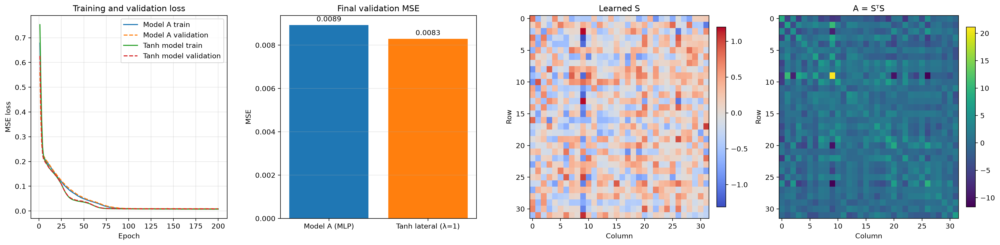

# Neural Model Experimentation Log

## Purpose

This workspace explores recurrent lateral interactions in neuron models, from numerical simulation of the state dynamics to supervised regression comparisons. The final regression configuration is a 32-hidden-unit tanh lateral model with fixed `lambda = 1`, compared with a 32-hidden-unit MLP.

## Final Regression Experiment

`neuron_regression.py` generates a reproducible synthetic regression dataset with seed 42: 3,000 samples, 8 input features, and additive Gaussian noise with standard deviation 0.08. The first 2,400 samples are used for training and the final 600 for validation. The target combines a tanh projection, a sinusoidal term, and noise.

Both models use 32 hidden units and are trained with Adam for 200 epochs, batch size 64, and learning rate 0.001. Model A is a two-layer ReLU MLP. The final lateral model uses

`A = S.T @ S / D`

and `Sigma(z) = A @ tanh(z)`, evaluated using 20 damped recurrent updates. Its interaction strength is fixed at `lambda = 1`; the script no longer performs a lambda sweep or a capacity sweep.

The final saved figure reports validation MSE rounded to four decimals: approximately 0.0089 for the MLP and 0.0083 for the tanh lateral model. This is an approximately 6.7% reduction relative to the MLP, based on rounded values. Training and validation loss curves and heatmaps for learned `S` and raw `S.T @ S` are also shown.



## Statistical Comparison

The script computes squared error separately for every validation sample, then forms paired differences (`MLP squared error - tanh squared error`). It applies Shapiro-Wilk to those differences. If normality is not rejected at 0.05, it reports a two-sided paired t-test; otherwise it uses a two-sided Wilcoxon signed-rank test. The console output includes the test statistic, p-value, Shapiro-Wilk p-value, and mean paired difference.

The lambda value and model direction were explored using this validation split, so the reported p-value is exploratory rather than a fully independent confirmatory result. For a confirmatory significance claim, evaluate the finalized configuration on a new held-out test set or use nested cross-validation.

## Learned Lateral Matrix Diagnostics

After training, the script reports the eigenvalues of raw `S.T @ S`, the condition number of `I + lambda * (S.T @ S)`, and the condition number of the normalized matrix `I + lambda * (S.T @ S / D)`. It also plots heatmaps for `S` and raw `S.T @ S`.

Because the final tanh model uses iterative nonlinear dynamics rather than a direct linear solve, these condition numbers are linear-system diagnostics/proxies; they are not the condition number of the nonlinear update itself. The saved final figure is the visual reference for the trained matrices.

## Experiment History

1. **Explicit Euler prototype:** `ODE_sigma.py` simulates `tau * dz/dt = -z + y - lambda * Sigma(z)`, with a linear kernel, rectification, and spectral/delta-norm diagnostics.
2. **More stable integration:** `recurrent_neuron_sim.py` adds backward Euler for linear kernels, a semi-implicit update for general kernels, spectral diagnostics, and linear, separable, and divisive kernel helpers.
3. **Updated simulation utilities:** `recurrent_neuron_sim_updated.py` adds normalized-kernel support and configurable snapshot intervals. The example's spectral diagnostic was corrected to receive the evaluated Jacobian matrix rather than the Jacobian function.
4. **Regression baseline:** `neuron_regression.py` initially compared an MLP with a linear lateral layer on synthetic regression data and recorded training/validation losses and final MSE.
5. **Interaction-strength exploration:** a linear-model sweep used `lambda` values 0, 0.1, 0.3, 1, 3, and 10. The plotted minimum was at `lambda = 1`; this value was retained for the final nonlinear experiment.
6. **Capacity and scaling explorations:** hidden sizes 16, 32, 64, and 128 were compared; a follow-up tested `A / D` normalization to control the scale of pooled interactions as width changes.
7. **Nonlinear interaction exploration:** the linear solve was replaced by damped iterative dynamics with `tanh(z)`. An L1 penalty on `S` was also explored as an optional training mode. These comparisons are historical experiments; the final run uses the tanh model at width 32 and does not apply L1 regularization.
8. **Final selection:** width 32, `lambda = 1`, tanh interactions, normalized `A`, per-sample paired error analysis, and learned-matrix diagnostics.

## PNG Results in the Workspace

The numbered figures are exploratory snapshots from earlier stages. `experiment_final_results.png` is regenerated by the current script and is the authoritative image for the final 32-unit, `lambda = 1` tanh configuration.

| Image | Reference |
|---|---|
| Initial loss curves and MSE comparison | [Figure_1.png](Figure_1.png) |
| Linear-model lambda sweep | [Figure_2.png](Figure_2.png) |
| Hidden-dimension comparison | [Figure_3.png](Figure_3.png) |
| Capacity comparison with `A / D` normalization | [Figure_4.png](Figure_4.png) |
| Nonlinear tanh capacity comparison | [Figure_5.png](Figure_5.png) |
| L1-regularized lateral structure comparison | [Figure_6.png](Figure_6.png) |
| Fixed-lambda tanh model and learned-matrix heatmaps | [Figure_7.png](Figure_7.png) |
| Current final run: losses, MSE, `S`, and `S.T @ S` | [experiment_final_results.png](experiment_final_results.png) |

## Reproducing the Final Result

From the workspace root, with the project virtual environment active:

```bash
./.venv/Scripts/python.exe neuron_regression.py
```

The script prints the MSE and paired-test diagnostics, displays the result figure, and overwrites `experiment_final_results.png` in the current working directory. Runtime dependencies are PyTorch, NumPy, Matplotlib, and SciPy.
